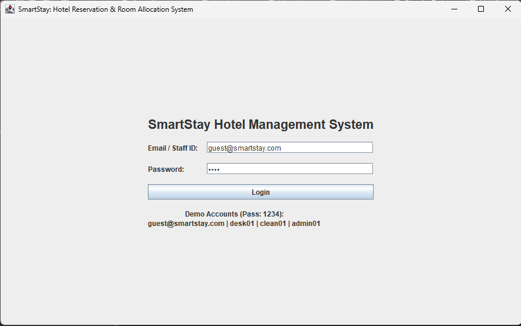
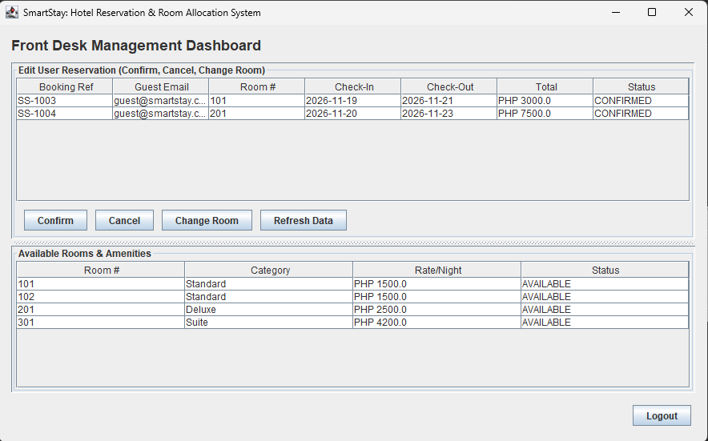
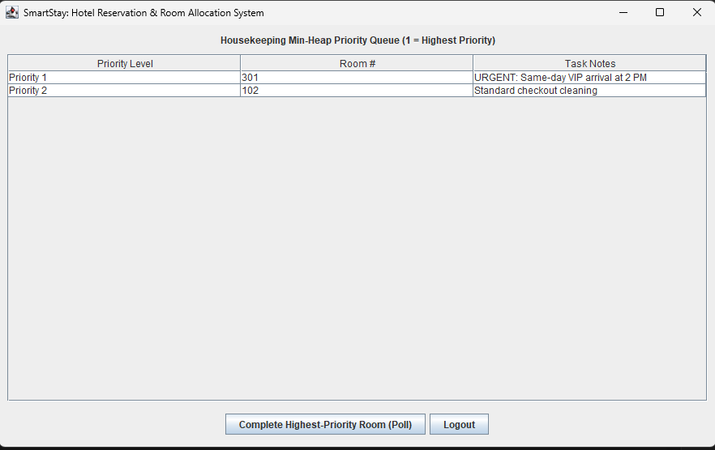
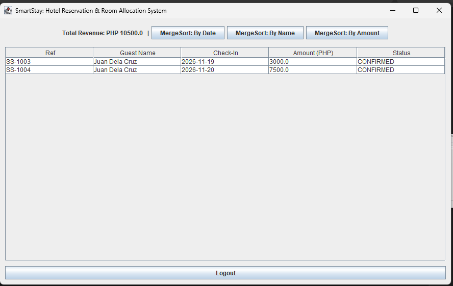

# SmartStay: Hotel Reservation & Room Allocation System

A Java Swing desktop hotel reservation and room allocation application built with object-oriented design and core data structures.

## Features & Roles

* **Guest (`GUEST`)**: Search available rooms by check-in/check-out dates and room category (`Standard`, `Deluxe`, `Suite`), book rooms with automatic total calculation and reward points, or join the FIFO waitlist queue[cite: 4, 5, 6, 9].
* **Front Desk (`FRONT_DESK`)**: View user reservations and room/amenity status, and perform reservation CRUD/management actions (**Confirm**, **Cancel** with FIFO waitlist queue pop, and **Change Room** with date-overlap conflict checks)[cite: 4, 6, 8].
* **Housekeeping (`HOUSEKEEPING`)**: Process room cleaning tasks ordered by priority using a Min-Heap (`PriorityQueue`) and mark rooms back to `AVAILABLE`[cite: 2, 4, 6, 10].
* **Admin (`ADMIN`)**: Access system reports and overview panels[cite: 4, 6].

## Data Structures Used

* **Hash Tables (`HashMap`)**: `O(1)` lookup for `users`, `rooms`, `bookings`, and per-room `roomSchedules`[cite: 6].
* **Interval-Overlap Scheduling**: Checks date overlaps (`startA < endB && endA > startB`) on sorted room schedules to prevent double-booking[cite: 6].
* **FIFO Queue (`Queue` / `LinkedList`)**: Manages guest waitlist entries and pops the next waiting entry upon cancellation[cite: 6].
* **Min-Heap Priority Queue (`PriorityQueue`)**: Orders `CleaningTask` items by priority (`1` = highest priority)[cite: 2, 6].
* **Merge Sort (`MergeSortUtil`)**: Sorts reservations by `AMOUNT`, `NAME`, or `DATE`[cite: 7].

## Demo Accounts

All demo accounts use password `1234`[cite: 6, 11]:

| Role | ID / Email | Name |
| :--- | :--- | :--- |
| Guest | `guest@smartstay.com` | Juan Dela Cruz[cite: 6] |
| Guest | `guest2@smartstay.com` | Jane Guest[cite: 6] |
| Front Desk | `desk01` | Maria FrontDesk[cite: 6] |
| Housekeeping | `clean01` | Pedro Housekeeping[cite: 6] |
| Admin | `admin01` | Admin Manager[cite: 6] |

## Project Structure

* `model/`: `Room`, `Reservation`, `User`, `CleaningTask`[cite: 2, 3, 4, 5]
* `service/`: `HotelSystem`, `MergeSortUtil`[cite: 6, 7]
* `ui/`: `MainFrame`, `LoginPanel`, `GuestBookingPanel`, `FrontDeskPanel`, `HousekeepingPanel`, `ReportsPanel`[cite: 8, 9, 10, 11]

## Screenshots

### Login Screen
[cite: 15]

### Front Desk Management & Reservation CRUD
[cite: 15]

### Housekeeping Priority Queue
[cite: 15]

### Admin Reports & Overview
[cite: 15]